<div align="center">
  <a href="https://github.com/CodeAXwOrlD">
    
  </a>

  <p align="center">
    <a href="https://www.linkedin.com/in/aggarwalakhil13032005/"></a>
    <a href="https://github.com/CodeAXwOrlD"></a>
    <a href="https://www.hackerrank.com/profile/aggarwal_akhil13"></a>
    <a href="mailto:aggarwalakhil2005@gmail.com"></a>
    
  </p>
</div>

---

### ⚡ Live Contribution Activity

<p align="center">
  
</p>

---

### 🖥️ Developer Terminal & Activity

<table align="center" border="0" style="border-collapse: collapse; border: none; width: 100%;">
  <tr style="border: none;">
    <td width="50%" align="center" style="border: none; padding: 6px; vertical-align: top;">
      
    </td>
    <td width="50%" align="center" style="border: none; padding: 6px; vertical-align: top;">
      
    </td>
  </tr>
</table>

---

### 🚀 About Me

```yaml
identity:
  name: "Akhil Agarwal"
  title: "Full-Stack & Backend Engineer"
  status: "Final-year B.Tech CSE @ Poornima University (CGPA: 8.5)"
  current_role: "Full Stack Developer (PPO) @ PixoraNest"
  certifications:
    - "Red Hat Certified Engineer (RHCE) — 2026"
    - "Red Hat Certified System Administrator (RHCSA) — 2025"
  focus_areas:
    - "High-performance backend systems & microservices"
    - "Asynchronous processing pipelines (FastAPI, Redis, Celery)"
    - "Native addon engineering (C++20 & Node-API)"
    - "DevOps automation, Docker containerization & AWS EC2 deployment"
    - "Applied Generative AI, LLM prompt engineering & voice agents"
```

---

### 🛠️ Technical Stack & Tooling

<div align="left">

#### 🖥️ Languages
<p>
  
  
  
  
  
  
</p>

#### ⚙️ Backend & Frameworks
<p>
  
  
  
  
  
  
</p>

#### 🎨 Frontend Architecture
<p>
  
  
  
  
</p>

#### 🗄️ Databases & Storage
<p>
  
  
  
  
  
</p>

#### 🚀 DevOps, Cloud & OS
<p>
  
  
  
  
  
  
</p>

#### 🤖 AI, Automation & Security
<p>
  
  
  
  
  
  
</p>

</div>

---

### 💼 Professional Experience

#### **Full Stack Developer Intern — PixoraNest**  
*May 2026 – Present | Jaipur, Rajasthan*  
*Awarded **Pre-Placement Offer (PPO)** based on engineering performance during internship.*

- **PixoraBot SaaS Platform**: Built a multi-tenant SaaS platform using React, TypeScript, and Supabase/PostgreSQL with serverless Edge Functions, white-label branding, and a visual WhatsApp chatbot builder powered by React Flow.
- **API Security & Multi-Tenant Isolation**: Implemented JWT verification, hierarchical role-based access control (super-admin, admin, client), origin allowlisting, and an SSRF-safe proxy for outbound n8n automations.
- **Omnichannel Automation**: Automated lead capture and follow-ups across WhatsApp Cloud API, RCS, and AI voice calls using n8n workflows, cron schedulers, and a 0–100 lead-scoring function serving 1,300+ leads.
- **In-House Voice Agent Migration**: Migrated a production LLM-powered multilingual voice agent from OmniDimension to an internal stack (FastAPI, Pipecat, Next.js, PostgreSQL), removing external vendor lock-in.
- **CI/CD & Root Cause Analysis**: Maintained automated GitHub Actions workflows (SSH deploy to AWS EC2 with Docker Compose and zero-downtime health checks); resolved complex production root causes (audio cutoffs, OAuth reverse-proxy issues, session drops) with regression test suites.

---

### 🛠️ Featured Projects

#### 1. [DocFlow](https://github.com/CodeAXwOrlD/DocFlow) &mdash; *Distributed Document Processing Pipeline*
`Python` &bull; `FastAPI` &bull; `Next.js` &bull; `PostgreSQL` &bull; `Redis` &bull; `Celery` &bull; `Docker Compose` &bull; `TypeScript`
- Engineered an asynchronous document processing platform that parses PDF, DOCX, XLSX, and CSV uploads into structured JSON, verifying file signatures via magic-byte inspection.
- Designed a distributed queue architecture using Celery and Redis featuring automatic backoff retries, late acknowledgements, and 4 concurrent workers, complemented by a manual retry API.
- Replaced HTTP polling with real-time SSE + Redis Pub/Sub progress streaming to the client UI (with an automatic fallback polling endpoint).
- Implemented human-in-the-loop review via a Next.js interactive JSON editor, recording review and finalize states in PostgreSQL.
- Containerized 6 microservices with Docker Compose; authored 18 automated pytest test cases and a continuous GitHub Actions CI pipeline.

#### 2. [IntelliCPP](https://github.com/CodeAXwOrlD/IntelliCPP) &mdash; *High-Performance C++20 Autocomplete Engine*
`C++20` &bull; `Node.js` &bull; `Express.js` &bull; `Node-API (N-API)` &bull; `React` &bull; `Monaco Editor`
- Engineered a native C++20 autocomplete engine featuring a custom Trie prefix search ($O(L)$) and regex symbol extraction resolving types across 14 STL containers.
- Exposed the native C++ engine directly into Node.js via Node-API (N-API) and integrated it with Monaco Editor, providing autocomplete suggestions and hover documentation with method signatures and Big-O complexity.
- Implemented an LRU cache in the Express backend to skip redundant AST parsing, coupled with rate limiting, a job queue, readiness probes, and sandboxed execution.
- Benchmarked at a **p95 latency of 2.7 ms** across 400 local requests, demonstrating Trie lookups ~8x faster than linear scans.

#### 3. [CredX](https://github.com/CodeAXwOrlD/CredX) &mdash; *Decentralized Academic Credential Platform*
`Node.js` &bull; `Express.js` &bull; `IPFS` &bull; `Auth0` &bull; `Next.js` &bull; **Hackathon Finalist**
- Solo-engineered the backend of a decentralized platform for issuing, cryptographic verification, and revocation of academic credentials.
- Designed REST APIs with Auth0 JWT middleware and strict role-based access control (RBAC) across Institution, Student, and Employer personas.
- Pinned credential records and audit metadata to IPFS for tamper-evident decentralized permanence; awarded **Finalist among 10,000+ participants**.

---

### 🏆 Certifications & Achievements

- 🏅 **Red Hat Certified Engineer (RHCE)** &bull; *Red Hat (2026)*
- 🏅 **Red Hat Certified System Administrator (RHCSA)** &bull; *Red Hat (2025)*
- 🏆 **ProofX Protocol Finalist (Top 40 / 10,000+ Participants - Top 0.4%)**: Built a ZK-SNARK based on-chain financial compliance and verification system.
- 🏆 **CredX Hackathon Finalist**: Recognized among 10,000+ developers for decentralized credential infrastructure.
- ⭐ **HackerRank**: 5-Star in C++, 4-Star in Python, 4-Star in SQL.
- 🤝 **Community**: Active Google Cloud Volunteer supporting hands-on developer workshops.

---

### 📬 Connect & Coding Profiles

<p align="center">
  <a href="https://www.linkedin.com/in/aggarwalakhil13032005/" target="_blank">
    
  </a>
  &nbsp;
  <a href="https://github.com/CodeAXwOrlD" target="_blank">
    
  </a>
  &nbsp;
  <a href="https://www.hackerrank.com/profile/aggarwal_akhil13" target="_blank">
    
  </a>
  &nbsp;
  <a href="mailto:aggarwalakhil2005@gmail.com" target="_blank">
    
  </a>
</p>

<p align="center">
  <sub>Generated with self-contained animated SVGs &bull; Auto-updated via GitHub Actions &bull; Crafted for Akhil Agarwal</sub>
</p>
